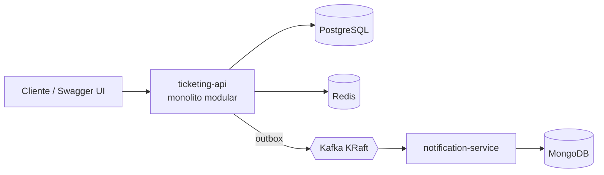

# Ticketing Platform

Plataforma de venta de entradas para eventos, construida como proyecto de portafolio con Java 21 y Spring Boot. El foco está en resolver bien la concurrencia sobre el stock, las reservas temporales, las transacciones, la caché, la mensajería asíncrona y la seguridad.

> Estado: **Fase 0 (esqueleto)** completada. Las funcionalidades de negocio se añaden fase a fase (ver `docs/decisions.md` y la sección "Hoja de ruta").

## Arquitectura (objetivo)



## Estructura del repositorio

| Módulo | Descripción |
| --- | --- |
| `common-events` | Contratos de eventos compartidos (records), p. ej. `EventEnvelope` |
| `ticketing-api` | Servicio principal (puerto 8080) |
| `notification-service` | Consumidor de eventos y notificaciones simuladas (puerto 8081) |
| `docs/` | ADRs y documentación técnica |

## Stack

Java 21 · Maven 3.9 (Maven Wrapper) · Spring Boot 3.5 · PostgreSQL 17 · Redis 7 · Apache Kafka 4 (KRaft) · MongoDB 7 · JUnit 5 · JaCoCo · Spotless · Docker Compose.

## Requisitos previos

- JDK 21 (por ejemplo Eclipse Temurin 21)
- Docker con Docker Compose v2
- No hace falta instalar Maven: se usa `./mvnw`

## Inicio rápido

```bash
# 1. Variables de entorno locales (edita los valores de ejemplo)
cp .env.example .env

# 2. Levantar solo las dependencias (Postgres, Redis, Kafka y Mongo)
docker compose --profile infra up -d
docker compose ps        # todos los servicios deben aparecer como "healthy"

# 3. Compilar y ejecutar todos los tests
./mvnw clean verify

# 4. Arrancar la API desde la terminal (o desde el IDE)
./mvnw -pl ticketing-api -am spring-boot:run
curl http://localhost:8080/actuator/health
```

Para detener y borrar los volúmenes: `docker compose --profile infra down -v`.

## Comandos útiles

| Comando | Qué hace |
| --- | --- |
| `./mvnw clean verify` | Compila, ejecuta tests unitarios (`*Test`) e integración (`*IT`), cobertura y formato |
| `./mvnw test` | Solo tests unitarios |
| `./mvnw -pl ticketing-api -am package` | Empaqueta únicamente la API y sus dependencias |
| `./mvnw spotless:apply` | Formatea el código (google-java-format) |

## Hoja de ruta

- [x] Fase 0: Esqueleto (Maven multi-módulo, Compose `infra`, `.env.example`)
- [ ] Fase 1: Dominio base (Flyway, entidades, CRUD, errores, Swagger)
- [ ] Fase 2: Seguridad (JWT, roles, propiedad, rate limiting)
- [ ] Fase 3: Reservas y órdenes (concurrencia, idempotencia, webhook, expiración)
- [ ] Fase 4: Redis (caché, TTL, degradación)
- [ ] Fase 5: Mensajería (outbox, Kafka, notification-service)
- [ ] Fase 6: Calidad e infraestructura (Dockerfiles, Compose `full`, Grafana, N+1)
- [ ] Fase 7: CI/CD y despliegue en AWS
- [ ] Fase 8: Pulido

## Decisiones técnicas

Ver [`docs/decisions.md`](docs/decisions.md).
