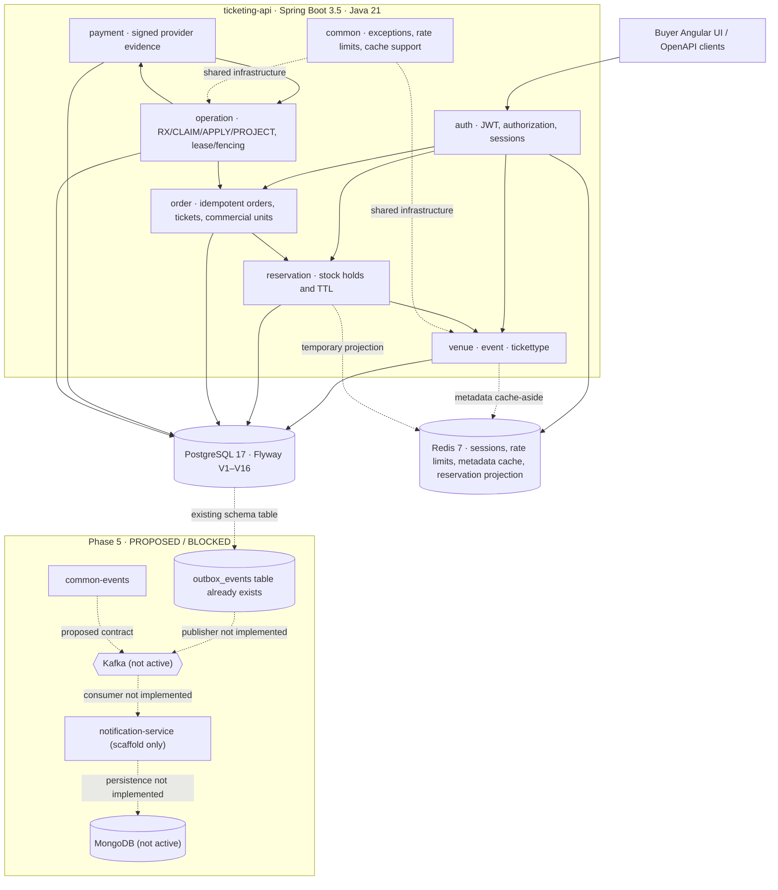

# Architecture

## System and module overview

Ticketing is a **modular monolith** implemented by `ticketing-api`: domain packages share one Java process and PostgreSQL transactions while owning separate business responsibilities. The remaining Maven modules isolate a shared event envelope and a **future, currently unimplemented** notification application.



### Responsibilities

| Maven module or package | Responsibility |
| --- | --- |
| `common-events` | Shared immutable `EventEnvelope<T>` contract, without coupling the services together. |
| `ticketing-api.auth` | Registration, login, access/refresh JWTs, logout, roles and Redis-backed login limits. |
| `ticketing-api.venue` | Venue CRUD and persistence. |
| `ticketing-api.event` | Event lifecycle, organizer ownership, schedule, venue and coordinated cancellation. |
| `ticketing-api.tickettype` | Ticket-type catalog, sale windows, atomic inventory reserve/release. |
| `ticketing-api.reservation` | Reservation creation/cancellation, TTL, payment confirmation and bounded expiration. |
| `ticketing-api.order` | Idempotent order creation, one-order-per-reservation enforcement, immutable price snapshots, cancellation, commercial units and ticket issuance. |
| `ticketing-api.payment` | HMAC webhook validation, provider evidence, operation identity, semantic application identity and append-only records. |
| `ticketing-api.operation` | Durable job cycles, RX/CLAIM/APPLY/PROJECT coordination, leases, fencing and projection recovery. |
| `ticketing-api.common` | Errors, domain base types, supporting infrastructure and HTTP conventions. |
| `notification-service` | Spring Boot application scaffold only. Functional Kafka consumers and MongoDB notifications remain blocked until Phase 5 authorization. |

## Buyer flow: reservation → order → simulated payment → tickets

```mermaid
sequenceDiagram
    autonumber
    actor U as Buyer
    participant API as ticketing-api
    participant DB as PostgreSQL
    participant Sim as Simulated provider

    U->>API: Reserve ticket type and quantity
    API->>DB: Acquire event/inventory locks; conditional stock UPDATE
    Note over API,DB: available_quantity >= requested quantity
    alt Stock available
      DB-->>API: One row changed
      API->>DB: INSERT reservation ACTIVE with expires_at
      API-->>U: Temporary reservation
      U->>API: Create order with Idempotency-Key
      API->>DB: Check user/key and lock reservation
      alt New idempotency key and unbound reservation
        API->>DB: INSERT order, immutable-price items, PENDING payment
        Note over API,DB: UNIQUE reservation_id includes cancelled orders
        API-->>U: Pending payment order
        U->>Sim: Simulate capture
        Sim->>API: Signed webhook payload + X-Signature
        API->>API: HMAC over exact raw UTF-8 bytes
        API->>DB: RX (evidence), CLAIM (lease/fencing)
        API->>DB: APPLY eligible commercial effect and durable disposition
        alt Reservation can be fulfilled
          API->>DB: PAID / SUCCEEDED, confirm hold, issue ticket units
        else Expired and not recoverable
          API->>DB: Persist SUCCEEDED, UNFULFILLABLE, refund REQUIRED
          Note over API,DB: Do not issue tickets or fabricate REFUNDED evidence
        end
        API->>DB: PROJECT result without reapplying committed APPLY
        API-->>Sim: Webhook accepted (204)
      else Same key and reservation
        API-->>U: Return the existing order
      else Conflicting key or reservation already has an order
        API-->>U: HTTP 409; create a fresh reservation for a new purchase
      end
    else Stock unavailable
      DB-->>API: Zero rows changed
      API-->>U: Inventory conflict
    end
```

### Consistency and concurrency invariants

1. **Inventory:** `TicketTypeRepository.reserveStock` uses one conditional PostgreSQL `UPDATE ticket_types ... WHERE available_quantity >= :quantity`. PostgreSQL serializes concurrent row writes; the affected row count determines success. Redis is never the authority for available stock.
2. **Reservation TTL:** the hold stores `expires_at`; the expiration worker discovers bounded batches using database time and then acquires and revalidates under E → T → R locks. `FOR UPDATE SKIP LOCKED` avoids waiting on already-claimed reservation rows; the conditional state transition releases stock at most once.
3. **Orders:** the order captures an immutable unit-price snapshot in `order_items`. PostgreSQL enforces uniqueness of `(user_id, idempotency_key)` and the V11 non-partial index `ux_orders_reservation_id`. Cancelled orders still occupy the original reservation identity. Conflicts map to HTTP 409 under the documented API contract.
4. **Payment identity:** webhook requests are authenticated by HMAC-SHA256 over the exact received payload. Separate persistent identities for `provider_events`, `provider_operations` and `semantic_applications` distinguish an event, a provider operation and a commercial effect. Evidence is append-only.
5. **Durable recovery:** RX persists evidence, CLAIM uses a lease and fencing token, APPLY records the committed disposition together with the commercial effects, and PROJECT updates the technical projection. **A recovered job whose APPLY already committed must reuse its prior result and must not invoke the commercial callback again.** A *new, independently signed provider event* may be evaluated under the SIMULATED evidence contract; the latter remains proposed in ADR-022.
6. **Late capture and refunds:** if a valid capture cannot fulfill a purchase, preserve financial evidence `SUCCEEDED` with `UNFULFILLABLE` and `REQUIRED` refund obligation, but issue no tickets. Only valid signed refund evidence can confirm `REFUNDED`. The provider is simulated: there is no actual monetary movement.
7. **Global locks:** all participating workflows must respect accepted [ADR-016](adr/ADR-016-global-lock-order.md), including implicit foreign-key locks and Hibernate flush behavior. Revalidate state after locking; do not infer safety from pre-lock entity snapshots.
8. **Outbox and notifications:** `outbox_events` is a schema placeholder only. No production business flow writes/publishes outbox messages; Kafka, the notification consumer and Mongo persistence belong to **blocked Phase 5**.

## Persistence and cache policy

The [ERD](erd.md) derives from Flyway V1–V16 (22 tables). PostgreSQL is authoritative for events, ticket types, inventory, reservations, orders, tickets, payments and durable operation state.

Redis stores hashed refresh-token identifiers, authentication/rate-limit counters, public event/ticket-type **metadata** and the temporary `ticketing:reservation:{id}` projection. `availableQuantity` is always read from PostgreSQL rather than cached. Cache and projection invalidations are coordinated after commit; venue changes trigger an `AFTER_COMMIT` application event for event-cache invalidation. Catalog and reservation-projection Redis failures allow fallback to PostgreSQL; refresh/session operations fail closed when the necessary Redis state cannot be checked.

## Known architectural decisions and open questions

- All monetary operations and refunds are simulated; there is no real external gateway.
- ADR-022 (SIMULATED refund reference/semantic evidence) is **PROPOSED** and needs an explicit Tech Lead decision.
- Coordinated event cancellation is tested, but `EventCancellationService` directly references persistence owned by other modules. [ADR-024](adr/ADR-024-event-cancellation-transactional-exception.md) proposes a **narrow** E → T → R → O transaction exception; it is **not approved** by publication.
- AUD-05 identified **additional** cross-module queries/coordinators beyond the proposed ADR-024 exception. Their disposition is separately tracked in [pending decisions](audit/PENDING-DECISIONS.md); do not assume a blanket exception.
- HTTP correlation ownership (AUD-10), optional additional operation cycles (AUD-12) and selected HTTP 201 Location contracts (AUD-03) remain subject to explicit design review.
- Integration tests requiring real PostgreSQL/Redis use Testcontainers and must run with Docker. A passing CI suite tests covered scenarios, not every possible interleaving.
- Phase 5 Kafka, outbox publishing, MongoDB notification persistence and consumers are not implemented or authorized. The existing scaffold is not evidence of delivery.

**Working branch:** `main` only. Earlier `dev` references are historical; see [the remediation dossier](audit/MAIN-REMEDIATION-2026-11-21.md).
