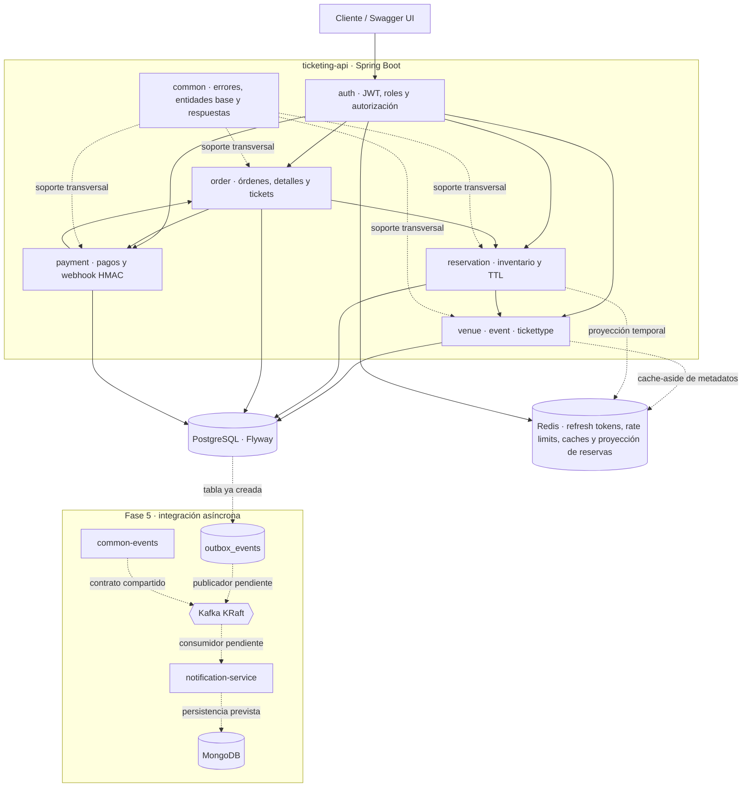

# Arquitectura

## Vista de módulos

La aplicación de negocio es un **monolito modular** en `ticketing-api`: los dominios comparten proceso y transacciones PostgreSQL, pero separan responsabilidades por paquete. Los módulos Maven adicionales aíslan contratos de eventos y el futuro consumidor de notificaciones.



### Responsabilidades

| Módulo / paquete | Responsabilidad |
| --- | --- |
| `common-events` | Records y envoltorio `EventEnvelope<T>`; contrato compartido sin dependencia de los servicios consumidores. |
| `ticketing-api.auth` | Registro/login, emisión y validación JWT, refresh/logout, roles y límites de login con Redis. |
| `ticketing-api.venue` | CRUD y persistencia de recintos. |
| `ticketing-api.event` | Ciclo de vida de eventos, organizador, fechas y recinto. |
| `ticketing-api.tickettype` | Tipos de entrada, ventana de venta y operaciones atómicas sobre inventario. |
| `ticketing-api.reservation` | Crear/cancelar reservas, TTL, confirmación durante el pago y expiración por lotes. |
| `ticketing-api.order` | Creación idempotente, unicidad de orden por reserva, snapshot de precio, estado de orden, cancelación y emisión/consulta de tickets. |
| `ticketing-api.payment` | Recepción HMAC, evidencia persistente del proveedor, identidad de operación, idempotencia semántica y aplicación/recuperación de operaciones financieras. |
| `notification-service` | Aplicación separada prevista para consumir eventos y gestionar notificaciones; integración Kafka pendiente de Fase 5. |

## Flujo de negocio: reserva → orden → pago → tickets

```mermaid
sequenceDiagram
    autonumber
    actor U as Usuario
    participant API as ticketing-api
    participant DB as PostgreSQL
    participant GW as Pasarela simulada

    U->>API: Crear reserva (tipo, cantidad)
    API->>DB: UPDATE condicional de inventario
    Note over API,DB: available_quantity >= quantity
    DB-->>API: 1 fila actualizada o 0
    alt Stock disponible
        API->>DB: INSERT reservation ACTIVE + expires_at
        DB-->>API: Reserva creada
        API-->>U: Reserva temporal
        U->>API: Crear orden + Idempotency-Key
        API->>DB: Buscar (user_id, idempotency_key)
        alt Clave nueva
            API->>API: OrderService.create verifica orden previa por reservation_id
            API->>DB: Validar reserva activa
            API->>DB: INSERT order + order_item (precio snapshot)
            Note over API,DB: V11 impone UNIQUE(reservation_id), incluso para órdenes CANCELLED
            API->>DB: INSERT payment PENDING
            API-->>U: Orden pendiente de pago
            U->>GW: Completar pago (flujo simulado)
            GW->>API: Webhook + X-Signature
            API->>API: Verificar HMAC-SHA256 del body original
            API->>DB: Bloquear/confirmar reserva y validar estado
            alt Reserva confirmada
                API->>DB: Marcar order PAID y payment SUCCEEDED
                API->>DB: Emitir tickets por cada unidad
                API-->>GW: Webhook procesado (204)
            else Reserva vencida y recuperación no posible
                API->>DB: Conservar evidencia SUCCEEDED
                API->>DB: fulfillment UNFULFILLABLE + refund REQUIRED
                Note over API,DB: No se emiten tickets; REFUNDED exige evidencia de reembolso
                API-->>GW: Webhook procesado (204)
            end
        else Misma clave y misma reserva
            API-->>U: Devolver orden existente
        else Misma clave y reserva diferente
            API-->>U: Conflicto (409)
        else Ya existe una orden para la reserva
            API-->>U: Conflicto (409); crear una reserva nueva para otra compra
        end
    else Stock insuficiente
        API-->>U: Conflicto de inventario
    end
```

### Consistencia y concurrencia

1. **Reserva de inventario:** `TicketTypeRepository.reserveStock` ejecuta un único `UPDATE ticket_types` con predicado `available_quantity >= :quantity`. La base de datos serializa las escrituras concurrentes sobre la fila y el número de filas afectadas determina el resultado. No se hace primero un SELECT de stock para luego descontarlo.
2. **Ventana de reserva:** la reserva guarda `expires_at` calculado con el TTL configurable. El job de expiración reclama lotes con `FOR UPDATE SKIP LOCKED`; dentro de la misma transacción cambia el estado y devuelve inventario solo si la transición condicional actualizó una fila.
3. **Orden:** el precio unitario se copia a `order_items`; una modificación posterior del catálogo no cambia el importe de la orden ya creada. `(user_id, idempotency_key)` tiene una restricción única en PostgreSQL. Adicionalmente, `OrderService.create` rechaza una orden previa para la reserva y V11 impone el índice único no parcial `ux_orders_reservation_id` sobre `orders(reservation_id)`. La restricción incluye órdenes canceladas; una reserva con orden cancelada no se reutiliza y una nueva compra requiere otra reserva. Las colisiones de integridad correspondientes se traducen a HTTP `409 Conflict`.
4. **Pago e idempotencia:** el webhook verifica HMAC-SHA256 sobre el cuerpo recibido y registra por separado la identidad del evento recibido, la operación del proveedor y la aplicación semántica (`provider_events`, `provider_operations`, `semantic_applications`). Una misma operación comercial se aplica una sola vez aunque llegue mediante eventos distintos o concurrentes. Si una captura tardía no puede recuperar la compra, se conserva `SUCCEEDED`, no se emiten tickets y la orden queda `UNFULFILLABLE` con reembolso `REQUIRED`; `REFUNDED` solo se confirma con evidencia válida de reembolso.
5. **Outbox y notificaciones:** la tabla `outbox_events` ya existe en el esquema, pero la escritura/publicación de eventos, Kafka y el consumidor `notification-service` aún no forman parte del flujo activo. Se implementarán en la Fase 5.

## Persistencia

El esquema y sus relaciones se documentan en [ERD](erd.md), derivado directamente de las migraciones Flyway. PostgreSQL es la fuente de verdad para catálogo, inventario, reservas, órdenes, tickets y pagos. Redis se utiliza para refresh tokens, rate limiting de login/reservas/órdenes, caché-aside de metadatos de tipos de entrada y eventos públicos, y la proyección temporal `ticketing:reservation:{id}`. La disponibilidad (`availableQuantity`) se consulta directamente en PostgreSQL en cada lectura y nunca se cachea. Las invalidaciones y la proyección de reservas se coordinan con el commit; los cambios de venue invalidan la caché de eventos mediante un evento de aplicación `AFTER_COMMIT`. Los fallos Redis de cache/proyección permiten continuar con PostgreSQL, mientras el refresh token store permanece fail-closed.

## Límites conocidos

- El proveedor de pago es simulado; no hay integración con un gateway externo real.
- La publicación del outbox y el flujo Kafka → notificaciones están pendientes de Fase 5.
- La cancelación coordinada de eventos está implementada y probada, pero `EventCancellationService` accede a repositorios/SQL de módulos vecinos. Se propone la excepción transaccional acotada [ADR-024](adr/ADR-024-event-cancellation-transactional-exception.md), pendiente de dictamen técnico; no se ha cambiado el contrato ni el código productivo.
- Los tests `*IT` que necesitan PostgreSQL/Redis mediante Testcontainers deben ejecutarse en un entorno con Docker. La documentación no sustituye esa verificación.
