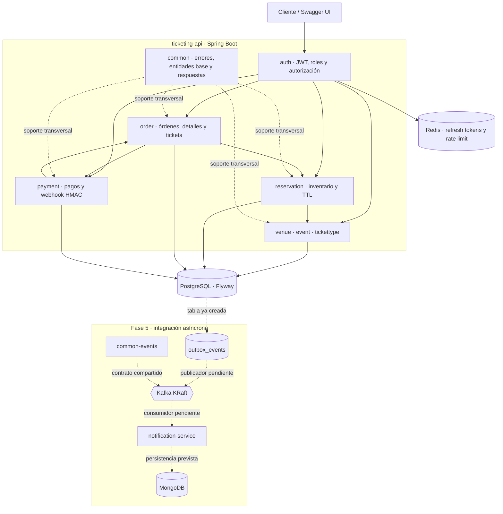
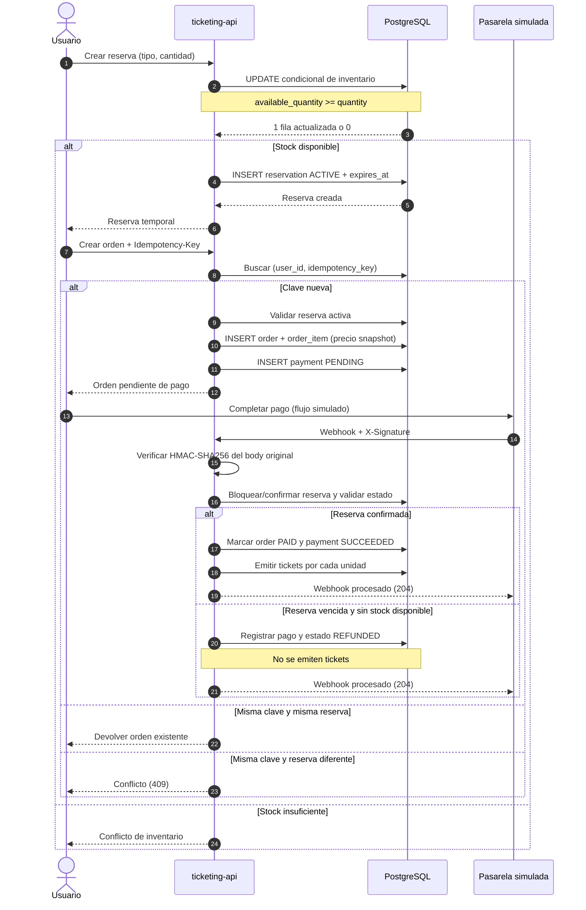

# Arquitectura

## Vista de módulos

La aplicación de negocio es un **monolito modular** en `ticketing-api`: los dominios comparten proceso y transacciones PostgreSQL, pero separan responsabilidades por paquete. Los módulos Maven adicionales aíslan contratos de eventos y el futuro consumidor de notificaciones.

### Responsabilidades

| Módulo / paquete | Responsabilidad |
| --- | --- |
| `common-events` | Records y envoltorio `EventEnvelope<T>`; contrato compartido sin dependencia de los servicios consumidores. |
| `ticketing-api.auth` | Registro/login, emisión y validación JWT, refresh/logout, roles y límites de login con Redis. |
| `ticketing-api.venue` | CRUD y persistencia de recintos. |
| `ticketing-api.event` | Ciclo de vida de eventos, organizador, fechas y recinto. |
| `ticketing-api.tickettype` | Tipos de entrada, ventana de venta y operaciones atómicas sobre inventario. |
| `ticketing-api.reservation` | Crear/cancelar reservas, TTL, confirmación durante el pago y expiración por lotes. |
| `ticketing-api.order` | Idempotencia de creación, snapshot de precio, estado de orden, cancelación y emisión/consulta de tickets. |
| `ticketing-api.payment` | Registro de pago y recepción de webhook autenticado mediante HMAC-SHA256. |
| `notification-service` | Aplicación separada prevista para consumir eventos y gestionar notificaciones; integración Kafka pendiente de Fase 5. |

## Flujo de negocio: reserva → orden → pago → tickets

### Consistencia y concurrencia

1. **Reserva de inventario:** `TicketTypeRepository.reserveStock` ejecuta un único `UPDATE ticket_types` con predicado `available_quantity >= :quantity`. La base de datos serializa las escrituras concurrentes sobre la fila y el número de filas afectadas determina el resultado. No se hace primero un SELECT de stock para luego descontarlo.
2. **Ventana de reserva:** la reserva guarda `expires_at` calculado con el TTL configurable. El job de expiración reclama lotes con `FOR UPDATE SKIP LOCKED`; dentro de la misma transacción cambia el estado y devuelve inventario solo si la transición condicional actualizó una fila.
3. **Orden:** el precio unitario se copia a `order_items`; una modificación posterior del catálogo no cambia el importe de la orden ya creada. `(user_id, idempotency_key)` tiene una restricción única en PostgreSQL.
4. **Pago:** el webhook verifica HMAC-SHA256 sobre el cuerpo recibido antes de procesar la transición. La orden y el pago se actualizan en una transacción; un pago exitoso confirma la reserva y emite un ticket por unidad del detalle.
5. **Outbox y notificaciones:** la tabla `outbox_events` ya existe en el esquema, pero la escritura/publicación de eventos, Kafka y el consumidor `notification-service` aún no forman parte del flujo activo. Se implementarán en la Fase 5.

## Persistencia

El esquema y sus relaciones se documentan en [ERD](erd.md), derivado directamente de las migraciones Flyway. PostgreSQL es la fuente de verdad para catálogo, inventario, reservas, órdenes, tickets y pagos. Redis se utiliza actualmente para refresh tokens y rate limiting de autenticación; la caché de catálogo y su estrategia de degradación son alcance de la Fase 4.

## Límites conocidos

- El proveedor de pago es simulado; no hay integración con un gateway externo real.
- La idempotencia de webhook se basa en las transiciones de estado y en `provider_reference`; todavía no existe una tabla de inbox/event IDs del proveedor.
- La publicación del outbox y el flujo Kafka → notificaciones están pendientes de Fase 5.
- Los tests `*IT` que necesitan PostgreSQL/Redis mediante Testcontainers deben ejecutarse en un entorno con Docker. La documentación no sustituye esa verificación.
