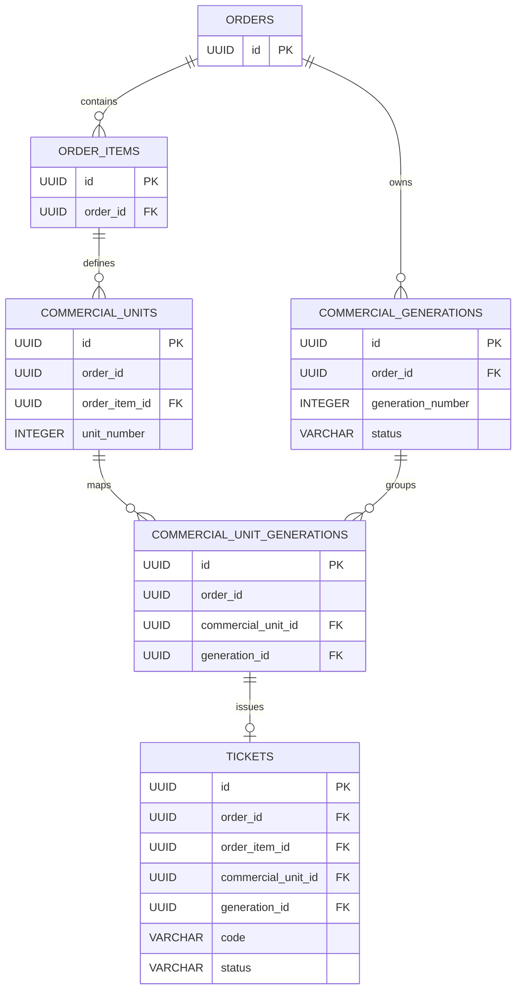
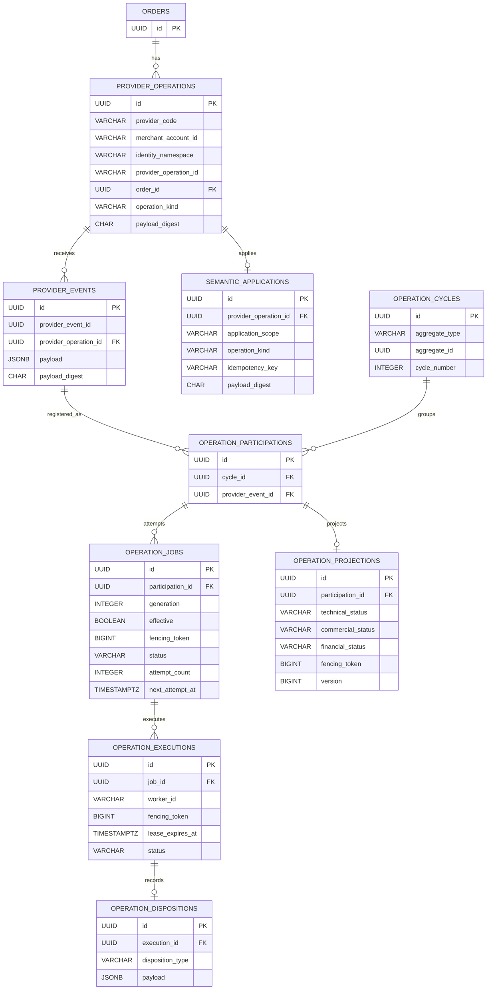

# Data model (ERD)

Source of truth: Flyway migrations `V1__create_users.sql` through `V16__commercial_units_and_generations.sql` under `ticketing-api/src/main/resources/db/migration/`. These three diagram views represent all 22 tables from V1–V16. Repeated audit fields are omitted for readability; Flyway DDL remains authoritative. No schema or migration is changed by this document.

```mermaid
erDiagram
    USERS {
        UUID id PK
        VARCHAR email UK
        VARCHAR password_hash
        VARCHAR full_name
        VARCHAR role
        BOOLEAN enabled
        TIMESTAMPTZ created_at
        TIMESTAMPTZ updated_at
    }
    VENUES {
        UUID id PK
        VARCHAR name
        VARCHAR city
        VARCHAR address
        INTEGER capacity
        TIMESTAMPTZ created_at
        TIMESTAMPTZ updated_at
    }
    EVENTS {
        UUID id PK
        UUID organizer_id FK
        UUID venue_id FK
        VARCHAR title
        TEXT description
        VARCHAR category
        TIMESTAMPTZ starts_at
        TIMESTAMPTZ ends_at
        VARCHAR status
        TIMESTAMPTZ created_at
        TIMESTAMPTZ updated_at
    }
    TICKET_TYPES {
        UUID id PK
        UUID event_id FK
        VARCHAR name
        NUMERIC price
        CHAR currency
        INTEGER total_quantity
        INTEGER available_quantity
        BIGINT version
        TIMESTAMPTZ sale_starts_at
        TIMESTAMPTZ sale_ends_at
        INTEGER max_per_order
        TIMESTAMPTZ created_at
        TIMESTAMPTZ updated_at
    }
    RESERVATIONS {
        UUID id PK
        UUID user_id FK
        UUID ticket_type_id FK
        INTEGER quantity
        VARCHAR status
        VARCHAR inventory_disposition
        TIMESTAMPTZ expires_at
        TIMESTAMPTZ created_at
        TIMESTAMPTZ updated_at
    }
    ORDERS {
        UUID id PK
        UUID user_id FK
        UUID reservation_id FK, UK
        VARCHAR status
        VARCHAR fulfillment_status
        VARCHAR refund_status
        NUMERIC total_amount
        CHAR currency
        VARCHAR idempotency_key
        TIMESTAMPTZ created_at
        TIMESTAMPTZ updated_at
    }
    ORDER_ITEMS {
        UUID id PK
        UUID order_id FK
        UUID ticket_type_id FK
        INTEGER quantity
        NUMERIC unit_price
        CHAR currency
        TIMESTAMPTZ created_at
        TIMESTAMPTZ updated_at
    }
    TICKETS {
        UUID id PK
        UUID order_item_id FK
        UUID order_id FK
        UUID commercial_unit_id FK
        UUID generation_id FK
        VARCHAR code UK
        VARCHAR status
        TIMESTAMPTZ created_at
        TIMESTAMPTZ updated_at
    }
    PAYMENTS {
        UUID id PK
        UUID order_id FK, UK
        VARCHAR status
        VARCHAR provider_reference UK
        VARCHAR refund_provider_reference UK
        NUMERIC amount
        CHAR currency
        TIMESTAMPTZ created_at
        TIMESTAMPTZ updated_at
    }
    OUTBOX_EVENTS {
        UUID id PK
        VARCHAR aggregate_type
        UUID aggregate_id
        VARCHAR event_type
        JSONB payload
        TIMESTAMPTZ created_at
        TIMESTAMPTZ updated_at
        TIMESTAMPTZ published_at
    }

    USERS ||--o{ EVENTS : organizes
    VENUES ||--o{ EVENTS : hosts
    EVENTS ||--o{ TICKET_TYPES : offers
    USERS ||--o{ RESERVATIONS : creates
    TICKET_TYPES ||--o{ RESERVATIONS : reserved_as
    USERS ||--o{ ORDERS : places
    RESERVATIONS ||--o| ORDERS : originates
    ORDERS ||--|{ ORDER_ITEMS : contains
    TICKET_TYPES ||--o{ ORDER_ITEMS : prices
    ORDER_ITEMS ||--o{ TICKETS : issues
    ORDERS ||--o| PAYMENTS : paid_by
```

## Integrity and domain constraints

- **Identity:** `users.email` is unique and must be stored in lowercase. Allowed roles are `USER`, `ORGANIZER`, and `ADMIN`.
- **Catalog:** each event belongs to an organizer and venue; each ticket type belongs to an event. The database uniqueness constraint on `(event_id, name)` is **case-sensitive**; the service's case-insensitive duplicate check has a separately documented concurrent race risk (BACK-01), pending reproduction and a technical decision. `available_quantity` must remain between zero and `total_quantity`.
- **Reservations:** each reservation belongs to one buyer and ticket type, with `quantity > 0`. Persisted states are `ACTIVE`, `CONFIRMED`, `EXPIRED`, and `CANCELLED`. The partial index `ix_reservations_active_expires_at` supports discovery of overdue active holds.
- **Orders:** each order belongs to a buyer and references one reservation. `UNIQUE(user_id, idempotency_key)` limits idempotency by buyer. V11 creates a non-partial unique index `ux_orders_reservation_id` on `orders(reservation_id)`: a reservation can have at most one order, **including cancelled orders**. A cancelled order's reservation cannot be reused for a new purchase.
- **Order creation:** `OrderService.create` checks for an existing order on the reservation before inserting; PostgreSQL enforces the same rule under concurrent requests through the unique index. Corresponding integrity conflicts map to HTTP `409 Conflict`.
- **Order items and tickets:** each `order_item` snapshots the quantity, unit price and currency at purchase time. Each ticket belongs to an order item and has a unique code.
- **Payments:** `UNIQUE(order_id)` limits each order to at most one payment. `provider_reference` is unique where present; PostgreSQL permits multiple SQL NULL values under a standard unique constraint.
- **Outbox:** `aggregate_id` is deliberately polymorphic and has no FK to one concrete table. The partial index `ix_outbox_events_unpublished` covers rows where `published_at IS NULL`. The table is present; functional publishing and Kafka consumption belong to **blocked Phase 5**.

## Flyway migrations

| Version | Table | Structural purpose |
| --- | --- | --- |
| V1 | `users` | User identity, role and unique email |
| V2 | `venues` | Venues and positive capacity |
| V3 | `events` | Organizer, venue, schedule and status |
| V4 | `ticket_types` | Price, sale window and inventory |
| V5 | `reservations` | Expiring holds and partial index |
| V6 | `orders` | Orders, status and buyer-scoped idempotency |
| V7 | `order_items` | Quantity/price snapshots per order |
| V8 | `tickets` | Issued tickets and unique code |
| V9 | `payments` | One-to-one order payment and unique reference |
| V10 | `outbox_events` | Durable placeholder for future asynchronous publication |
| V11 | `orders` | Non-partial `ux_orders_reservation_id`; at most one order per reservation, even if cancelled |

## Ticket generations and commercial units (V16)

The `ORDERS`, `ORDER_ITEMS`, and `TICKETS` nodes in this view are the **same tables** as those in the first view, not duplicated database tables.

V16 adds `UNIQUE(order_item_id, unit_number)` for commercial units, `UNIQUE(order_id, generation_number)` for generations, partial index `ux_commercial_generations_one_active` for one active generation per order and `UNIQUE(commercial_unit_id, generation_id)` for tickets. Foreign keys in `commercial_units` and `commercial_unit_generations` are **composite** and include `order_id`; this simplified diagram does not replace those constraints. V16 backfills existing tickets and adds immutable-identity/lifecycle transition triggers.

## Financial identity and recoverable operations (V14/V15)

- **Three identities (V14):** `provider_operations` enforces `UNIQUE(provider_code, merchant_account_id, identity_namespace, provider_operation_id)`; `provider_events` enforces `UNIQUE(provider_code, merchant_account_id, provider_event_id)`; `semantic_applications` enforces `UNIQUE(provider_operation_id)` and `UNIQUE(application_scope, operation_kind, idempotency_key)`. These evidence tables have append-only triggers.
- **Cycles (V15):** `operation_cycles` has `UNIQUE(aggregate_type, aggregate_id, cycle_number)`. The aggregate ID is **polymorphic, not a foreign key** to `orders`. `operation_participations` has `UNIQUE(cycle_id, provider_event_id)`.
- **Jobs and fencing:** `operation_jobs` has `UNIQUE(participation_id, generation)` and partial unique index `ux_operation_jobs_effective` on `participation_id` where `effective=true`. `operation_executions` has `UNIQUE(job_id, fencing_token)` and lease. `operation_projections` is unique by participation and has a version; `operation_dispositions` is unique by execution, with `APPLIED`, `NO_OP`, and `FAILED` dispositions and append-only trigger.
- **Outbox (V10):** `outbox_events.aggregate_id` has no FK because it is polymorphic. No publisher exists; Kafka is Phase 5 work.

## Subsequent schema changes after V11

| Version | Affected tables | Implemented change |
| --- | --- | --- |
| V12 | `reservations` | `inventory_disposition` with CHECK: `ACTIVE/HELD`, `CONFIRMED/CONSUMED`, `EXPIRED|CANCELLED/RELEASED`; backfill |
| V13 | `orders`, `payments` | `fulfillment_status`, `refund_status`, and unique `refund_provider_reference` |
| V14 | `provider_operations`, `provider_events`, `semantic_applications` | Unique identities, digests and append-only triggers |
| V15 | `operation_cycles`, `operation_participations`, `operation_jobs`, `operation_executions`, `operation_dispositions`, `operation_projections` | Cycles, jobs, leases, fencing, dispositions and projections |
| V16 | `commercial_generations`, `commercial_units`, `commercial_unit_generations`; `tickets` | Stable units, generations, backfill, composite FKs, transitions and triggers |

V16 preserves `order_id` relationships and commercial unit/ticket/generation membership with composite FKs, not a standalone FK on `commercial_units.order_id`. These diagrams omit some `created_at`/`updated_at` and other audit fields. Read Flyway migrations for exact DDL and [ADR-016](adr/ADR-016-global-lock-order.md) for the implicit foreign-key lock audit.

**Official sources:** [PostgreSQL 17 — constraints](https://www.postgresql.org/docs/17/ddl-constraints.html) and [row locks](https://www.postgresql.org/docs/17/explicit-locking.html).
