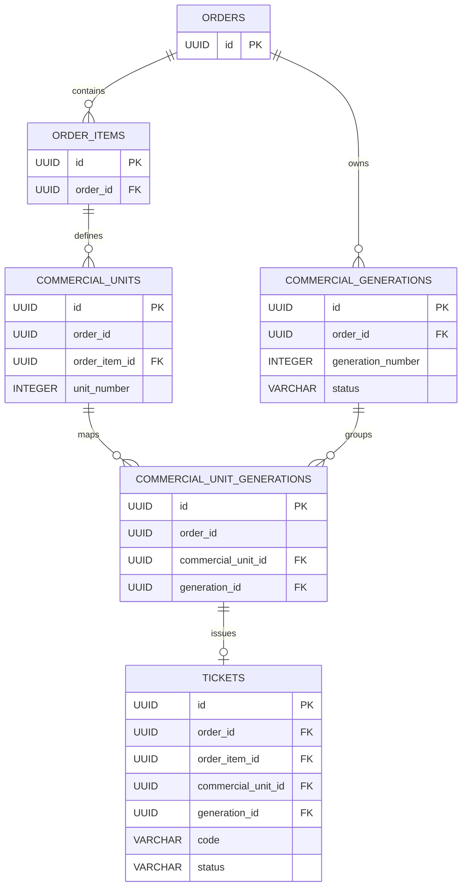
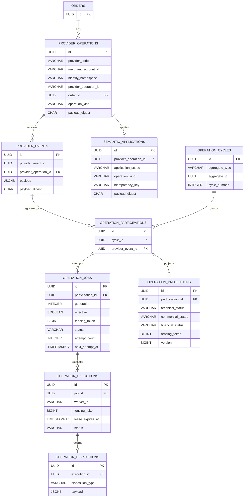

# Modelo de datos (ERD)

Fuente de verdad: migraciones Flyway `V1__create_users.sql` a `V16__commercial_units_and_generations.sql` en `ticketing-api/src/main/resources/db/migration/`. Los siguientes diagramas reflejan las 22 tablas de las migraciones V1–V16, distribuidas en tres vistas; se omiten columnas de auditoría repetidas para mantener la lectura. El DDL Flyway es la fuente de verdad exhaustiva. No se cambian tablas ni migraciones.

```mermaid
erDiagram
    USERS {
        UUID id PK
        VARCHAR email UK
        VARCHAR password_hash
        VARCHAR full_name
        VARCHAR role
        BOOLEAN enabled
        TIMESTAMPTZ created_at
        TIMESTAMPTZ updated_at
    }
    VENUES {
        UUID id PK
        VARCHAR name
        VARCHAR city
        VARCHAR address
        INTEGER capacity
        TIMESTAMPTZ created_at
        TIMESTAMPTZ updated_at
    }
    EVENTS {
        UUID id PK
        UUID organizer_id FK
        UUID venue_id FK
        VARCHAR title
        TEXT description
        VARCHAR category
        TIMESTAMPTZ starts_at
        TIMESTAMPTZ ends_at
        VARCHAR status
        TIMESTAMPTZ created_at
        TIMESTAMPTZ updated_at
    }
    TICKET_TYPES {
        UUID id PK
        UUID event_id FK
        VARCHAR name
        NUMERIC price
        CHAR currency
        INTEGER total_quantity
        INTEGER available_quantity
        BIGINT version
        TIMESTAMPTZ sale_starts_at
        TIMESTAMPTZ sale_ends_at
        INTEGER max_per_order
        TIMESTAMPTZ created_at
        TIMESTAMPTZ updated_at
    }
    RESERVATIONS {
        UUID id PK
        UUID user_id FK
        UUID ticket_type_id FK
        INTEGER quantity
        VARCHAR status
        VARCHAR inventory_disposition
        TIMESTAMPTZ expires_at
        TIMESTAMPTZ created_at
        TIMESTAMPTZ updated_at
    }
    ORDERS {
        UUID id PK
        UUID user_id FK
        UUID reservation_id FK_UK
        VARCHAR status
        VARCHAR fulfillment_status
        VARCHAR refund_status
        NUMERIC total_amount
        CHAR currency
        VARCHAR idempotency_key
        TIMESTAMPTZ created_at
        TIMESTAMPTZ updated_at
    }
    ORDER_ITEMS {
        UUID id PK
        UUID order_id FK
        UUID ticket_type_id FK
        INTEGER quantity
        NUMERIC unit_price
        CHAR currency
        TIMESTAMPTZ created_at
        TIMESTAMPTZ updated_at
    }
    TICKETS {
        UUID id PK
        UUID order_item_id FK
        UUID order_id FK
        UUID commercial_unit_id FK
        UUID generation_id FK
        VARCHAR code UK
        VARCHAR status
        TIMESTAMPTZ created_at
        TIMESTAMPTZ updated_at
    }
    PAYMENTS {
        UUID id PK
        UUID order_id FK_UK
        VARCHAR status
        VARCHAR provider_reference UK
        VARCHAR refund_provider_reference UK
        NUMERIC amount
        CHAR currency
        TIMESTAMPTZ created_at
        TIMESTAMPTZ updated_at
    }
    OUTBOX_EVENTS {
        UUID id PK
        VARCHAR aggregate_type
        UUID aggregate_id
        VARCHAR event_type
        JSONB payload
        TIMESTAMPTZ created_at
        TIMESTAMPTZ updated_at
        TIMESTAMPTZ published_at
    }

    USERS ||--o{ EVENTS : organizes
    VENUES ||--o{ EVENTS : hosts
    EVENTS ||--o{ TICKET_TYPES : offers
    USERS ||--o{ RESERVATIONS : creates
    TICKET_TYPES ||--o{ RESERVATIONS : reserved_as
    USERS ||--o{ ORDERS : places
    RESERVATIONS ||--o| ORDERS : originates
    ORDERS ||--|{ ORDER_ITEMS : contains
    TICKET_TYPES ||--o{ ORDER_ITEMS : prices
    ORDER_ITEMS ||--o{ TICKETS : issues
    ORDERS ||--o| PAYMENTS : paid_by
```

## Integridad y reglas relevantes

- **Identidad:** `users.email` es único y debe almacenarse en minúsculas. Los roles permitidos son `USER`, `ORGANIZER` y `ADMIN`.
- **Catálogo:** un evento pertenece a un organizador y a un recinto. Un tipo de entrada pertenece a un evento; `(event_id, name)` es único. `available_quantity` debe permanecer entre cero y `total_quantity`.
- **Reserva:** cada reserva pertenece a un usuario y a un tipo de entrada. `quantity > 0`; los estados persistidos son `ACTIVE`, `CONFIRMED`, `EXPIRED` y `CANCELLED`. El índice parcial `ix_reservations_active_expires_at` acelera el barrido de reservas activas vencidas.
- **Orden:** cada orden pertenece a un usuario y referencia exactamente una reserva. `UNIQUE(user_id, idempotency_key)` limita la idempotencia por usuario. V11 crea el índice único no parcial `ux_orders_reservation_id` sobre `orders(reservation_id)`: una reserva puede tener cero o una orden. La restricción incluye órdenes canceladas; una reserva cuya orden fue cancelada no puede reutilizarse y requiere crear una reserva nueva.
- **Creación de orden:** `OrderService.create` comprueba si existe una orden para la reserva antes de insertar. PostgreSQL protege la misma regla ante solicitudes concurrentes mediante el índice único; los conflictos de integridad se traducen a HTTP `409 Conflict`.
- **Detalle y tickets:** cada `order_item` conserva cantidad, precio unitario y moneda al momento de la compra. Cada ticket pertenece a un detalle y su código es único.
- **Pago:** `UNIQUE(order_id)` impone como máximo un pago por orden; `provider_reference` también es única (PostgreSQL permite múltiples valores NULL en esta restricción).
- **Outbox:** `aggregate_id` es deliberadamente polimórfico y no tiene FK a una tabla concreta. El índice parcial `ix_outbox_events_unpublished` cubre filas cuyo `published_at` aún es NULL. La tabla está creada; el publicador y el consumo Kafka corresponden a la Fase 5.

## Migraciones

| Versión | Tabla | Decisión estructural |
| --- | --- | --- |
| V1 | `users` | identidad, rol y correo único |
| V2 | `venues` | recintos y capacidad positiva |
| V3 | `events` | organizador, recinto, fechas y estado |
| V4 | `ticket_types` | precio, ventana de venta e inventario |
| V5 | `reservations` | reserva temporal con vencimiento e índice parcial |
| V6 | `orders` | orden, estado e idempotencia por usuario |
| V7 | `order_items` | snapshot de cantidad/precio por orden |
| V8 | `tickets` | tickets emitidos y código único |
| V9 | `payments` | pago 1:1 con orden y referencia única |
| V10 | `outbox_events` | registro durable para futura publicación asíncrona |
| V11 | `orders` | índice único no parcial `ux_orders_reservation_id`; máximo una orden por reserva, incluso cancelada |

## Generaciones de tickets y unidades comerciales (V16)

Las tablas `ORDERS`, `ORDER_ITEMS` y `TICKETS` de esta segunda vista son las **mismas** entidades del diagrama inicial, no copias.



V16 añade `UNIQUE(order_item_id, unit_number)` en unidades comerciales, `UNIQUE(order_id, generation_number)` en generaciones, índice parcial `ux_commercial_generations_one_active` para una generación activa por orden y `UNIQUE(commercial_unit_id, generation_id)` en tickets. Las FK de `commercial_units` y `commercial_unit_generations` son **compuestas** e incluyen `order_id`; la representación simplificada no sustituye esas restricciones. La migración realiza backfill para tickets existentes y aplica triggers de identidad append-only y transiciones finales a tickets/generaciones.

## Identidades financieras y operaciones recuperables (V14/V15)



- **Tres identidades (V14):** `provider_operations` tiene `UNIQUE(provider_code, merchant_account_id, identity_namespace, provider_operation_id)`; `provider_events`, `UNIQUE(provider_code, merchant_account_id, provider_event_id)`; `semantic_applications`, `UNIQUE(provider_operation_id)` y `UNIQUE(application_scope, operation_kind, idempotency_key)`. Estas tablas tienen triggers append-only.
- **Ciclos (V15):** `operation_cycles` tiene `UNIQUE(aggregate_type, aggregate_id, cycle_number)`; `aggregate_id` es **polimórfico y NO una FK** a `orders`. `operation_participations` tiene `UNIQUE(cycle_id,provider_event_id)`.
- **Jobs y fencing:** `operation_jobs` tiene `UNIQUE(participation_id,generation)` e índice único parcial `ux_operation_jobs_effective` sobre `participation_id` cuando `effective=true`; `operation_executions`, `UNIQUE(job_id,fencing_token)` y lease. `operation_projections` tiene `UNIQUE(participation_id)` y versión; `operation_dispositions`, `UNIQUE(execution_id)`, tipos `APPLIED`, `NO_OP` y `FAILED` y trigger append-only.
- **Outbox (V10):** `outbox_events.aggregate_id` no tiene FK por ser polimórfico. Sigue sin publicador; Kafka corresponde a Fase 5.

## Evolución posterior a V11

| Versión | Tablas afectadas | Cambio real |
| --- | --- | --- |
| V12 | `reservations` | `inventory_disposition` con CHECK: `ACTIVE/HELD`, `CONFIRMED/CONSUMED`, `EXPIRED|CANCELLED/RELEASED`; backfill |
| V13 | `orders`, `payments` | `fulfillment_status`, `refund_status` y `refund_provider_reference` única |
| V14 | `provider_operations`, `provider_events`, `semantic_applications` | Identidades únicas, digests y triggers append-only |
| V15 | `operation_cycles`, `operation_participations`, `operation_jobs`, `operation_executions`, `operation_dispositions`, `operation_projections` | Ciclos, jobs, leases, fencing, disposiciones y proyecciones |
| V16 | `commercial_generations`, `commercial_units`, `commercial_unit_generations`; `tickets` | Unidades estables, generaciones, backfill, FK compuestas, transiciones y triggers |

La migración V16 conserva relaciones por `order_id` y relaciones entre unidad/ticket/generación mediante FK compuestas; no equivale a una simple FK aislada desde `commercial_units.order_id`. Los diagramas no representan `created_at/updated_at` ni todos los campos de auditoría. Consultar las migraciones Flyway para la estructura exhaustiva y [ADR-016](adr/ADR-016-global-lock-order.md) para la auditoría de locks de claves foráneas.

**Referencias oficiales:** [PostgreSQL 17 — constraints](https://www.postgresql.org/docs/17/ddl-constraints.html) y [bloqueos de fila](https://www.postgresql.org/docs/17/explicit-locking.html).
