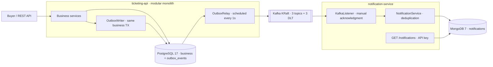
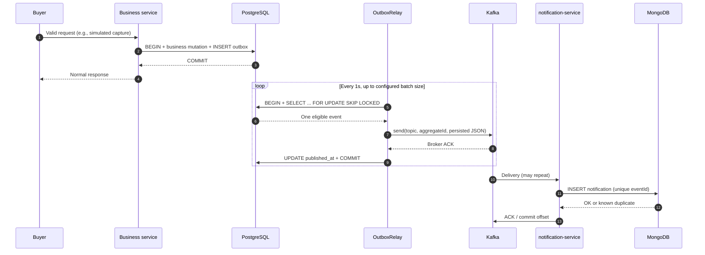

# F5-01 — Proposed Phase 5 comprehensive technical design

- **Status:** **PROPOSED / NOT APPROVED / NOT IMPLEMENTED. Phase 5 BLOCKED.**
- **Design date:** 2026-11-14.
- **Historical audited branch/SHA:** former `dev` at `73eb12d307af696533ba182574d7f9f54ab2ec42`.
- **Historical CI baseline:** #310 `success`; 390 API unit tests, 170 integration tests, Spotless and JaCoCo. This is **not current main evidence**.
- **Mandatory entry:** independent formal Phase 3 and Phase 4 closure, review of proposed ADR-023 and separate explicit Phase 5 start authorization.
- **Goal after authorization:** validate the existing application locally, then build Transactional Outbox → Kafka → notification-service → MongoDB with simulated notifications. **No AWS, real payments or real email.**

## 1. Sources and original baseline review

The scope came from the original technical specification (``1–3, 12–16, 22 and 24). At the historical SHA, the reviewer inspected the GitHub tree (431 entries), Maven modules, Flyway V1–V16, business-transition services, tests, F4-01–F4-05 and ADR-016–022. The old design explicitly lacked a complete local manual validation, so it did not claim empirical coverage of every execution path. A later local API smoke walkthrough was recorded separately and must not be backdated into this design.

| Component | Present at historical SHA | Proposed approach |
| --- | --- | --- |
| Java 21 / Spring Boot 3.5.16 monorepo | `ticketing-api`, `common-events`, `notification-service` | Keep modular monolith and separate consumer |
| PostgreSQL 17 / Flyway V1–V16 | Business, operation, generation and outbox tables | Never edit applied migrations |
| V10 `outbox_events` | `id`, `aggregate_type`, `aggregate_id`, `event_type`, `payload`, timestamps, `published_at`, unpublished partial index | Reuse initially; no V17 without proof/approval |
| `EventEnvelope<T>` | `eventId`, `eventType`, `occurredAt`, `version`, `data` | Preserve envelope; add typed event-data records |
| `notification-service` | Spring Boot application with web/Actuator only | Later add Kafka/Mongo and protected internal query |
| Docker Compose `infra` | PostgreSQL, Redis, Kafka KRaft and Mongo; auto-create topics off | Explicit topic creation, applications initially run on host |
| Existing tests | PostgreSQL/Redis Testcontainers, historical CI #310 green | Add specialized Kafka/Mongo integration suites |
| Payments | SIMULATED provider only; ADR-022 proposed | Never integrate real payment service or invent a refund |

**Historical documentation debt:** at the time, `docs/erd.md` described V1–V11 although the database had V12–V16. The ERD was subsequently updated to 22 tables/V16. Event-cancellation ADR-024 and simulated-refund ADR-022 remain proposed. This translation does **not** approve either design or initiate Phase 5.

## 2. Future requirements and non-goals

**Proposed functions:** `OrderConfirmed`, `OrderCancelled`, `OrderRefunded`, `ReservationExpired` and `EventCancelled`; Kafka topics `ticketing.orders`, `ticketing.reservations` and `ticketing.events`, each with three partitions and replication factor 1 **for local development**; a one-second outbox relay; a consumer with manual acknowledgment and dead-letter topics `<topic>.DLT`; persisted simulated Mongo notification with unique `eventId`; internal paginated `GET /notifications?userId=...` protected by an API key. Notification means a simulated text record, **never SMTP/email delivery**.

**Proposed nonfunctional behavior:** atomic business + outbox in one PostgreSQL transaction; at-least-once Kafka delivery and idempotent consumer; aggregate ID as Kafka partition key; Kafka outage must not block already committed business; Testcontainers and reproducible local runs; environment-configured secrets; zero paid infrastructure.

**Explicit non-goals:** end-to-end exactly-once; distributed PostgreSQL/Kafka/Mongo 2PC; sagas/CQRS; Debezium/Kafka Connect; cloud platform; real emails; admin dashboard; redesign of payment/refund policy.

**Open inconsistency to resolve:** original specification mentions three delivery attempts, an older outline says three retries, while this detailed design proposes initial + two retries. Record a definite contract before implementation, rather than silently choosing one.

## 3. Container architecture and proposed flow





**Precise guarantee:** Business/outbox are committed atomically in PostgreSQL. Kafka and PostgreSQL do **not** share a distributed transaction. If the broker ACKs before PostgreSQL records `published_at` and PostgreSQL later rolls back, the same message may be published again. Duplicate delivery is expected; the consumer must deduplicate by `eventId`.

## 4. Proposed V1 event contract

Reuse `EventEnvelope<T>` from `common-events`, **without adding Kafka dependencies to that module**. Add typed event-data records with `recipientUserId`, `recipientEmail`, `correlationId`, aggregate identity and only fields needed for simulated message composition; `EventCancelled` includes a concise event title/name.

Never include bearer tokens, HMAC secrets/signatures or financial provider references. The envelope `eventId` must be the same as `outbox_events.id`. Use `version=1` and fix `occurredAt` at persistence time, **not each retransmission**. Persist the **entire envelope JSON** in the outbox `payload` and publish it unchanged. Kafka record key is `aggregateId.toString()`.

| Event type | Kafka topic | Aggregate / Kafka key | Exactly when to write |
| --- | --- | --- | --- |
| `OrderConfirmed` | `ticketing.orders` | orderId | Payment confirmed, tickets issued and order fulfilled; **not** `UNFULFILLABLE` |
| `OrderCancelled` | `ticketing.orders` | orderId | Effective order transition to `CANCELLED` (buyer, payment failure or event cancellation) |
| `OrderRefunded` | `ticketing.orders` | orderId | **Real signed** refund evidence with actual `APPLIED` commercial effect; not `PENDING`, `FAILED` or `NO_OP` |
| `ReservationExpired` | `ticketing.reservations` | reservationId | Actual `ACTIVE → EXPIRED` via TTL/order expiration, not duplicate replay |
| `EventCancelled` | `ticketing.events` | eventId | Actual transition to `CANCELLED`; **proposal:** a distinct notification event per eligible recipient |

**EventCancelled recipients — requires explicit approval:** The organizer and affected buyers would be identified inside `ticketing-api` during the same event-cancellation transaction. The proposal writes one unique outbox event per recipient (own UUID) using the **same event aggregate ID as Kafka key**, avoiding PostgreSQL access or Mongo multi-document transactions in `notification-service`. Deduplicate recipients before insertion. Decide eligible reservation/order states and a bounded transactional fan-out limit before implementing.

**Correlation:** Data includes `correlationId`. An HTTP request would capture or generate `X-Correlation-Id` through a minimal validated filter; scheduled jobs generate a technical UUID. The relay would also forward the persisted correlation ID as a Kafka header. Logs use technical IDs, not complete emails/secrets. HTTP correlation is still an AUD-10 decision before implementation.

### Example envelope V1 — synthetic IDs

```json
{
  "eventId": "a2c20000-0000-4000-8000-000000000001",
  "eventType": "OrderConfirmed",
  "occurredAt": "2026-11-14T18:00:00Z",
  "version": 1,
  "data": {
    "orderId": "b2c20000-0000-4000-8000-000000000002",
    "recipientUserId": "c2c20000-0000-4000-8000-000000000003",
    "recipientEmail": "demo@example.com",
    "correlationId": "f5-local-demo-0001"
  }
}
```

**Compatibility:** The existing `EventEnvelope` retains its five fields; current public APIs need not change. Consumer validates `version` and `eventType`, routes unsupported evidence to DLT and must not fabricate notifications. New typed records do not necessarily require a parent-POM change.

## 5. Proposed outbox writes in business transactions — NOT IMPLEMENTED

Introduce a minimal `OutboxWriter` service/interface under `ticketing-api`, using JDBC and Spring propagation `MANDATORY`, invoked **only for an actual eligible state transition while the same business transaction is still open**. Do **not** write outbox records in `afterCommit` (would lose atomicity). Do **not** call Kafka directly from business services.

Candidate emission sites: `OrderPaymentService.processSuccess` after tickets; `OrderPaymentService.confirmRefund` after valid refund; `OrderCancellationService` / `OrderPaymentService.processFailure` / `EventCancellationService` for pending order cancellation; `ReservationExpirationService` / `OrderExpirationProcessor` when a reservation truly expires; `EventCancellationService` when event actually becomes cancelled. Prevent duplicate emission across coordinators and nested services.

Explicit `created_at=clock_timestamp()` would reflect actual DB insertion time rather than the beginning of a long transaction. The original plan orders by `(created_at,id)` per aggregate; **this is deterministic for visible timestamps but does not prove real business commit ordering under concurrent transactions**. Require a PostgreSQL concurrency test and an approved ordering contract before claiming per-aggregate business order.

If the business transaction fails, the outbox row must roll back with it. For RX/CLAIM/APPLY/PROJECT, only the already existing **business-changing APPLY transaction** writes a relevant outbox event. A `NO_OP` produces no notification.

## 6. Proposed minimum Kafka relay — NOT IMPLEMENTED

**Original portfolio recommendation, not accepted:** reuse V10 `outbox_events` without V17, one row per transaction, `SELECT ... FOR UPDATE SKIP LOCKED` and a bounded Kafka ACK wait. Avoid locking business tables. Up to 50 messages sequentially per `@Scheduled(fixedDelay=1000)` cycle; each message uses its own short transaction.

Conceptual query; analyze local PostgreSQL plan and the actual global lock requirements before implementation:

```sql
SELECT o.id, o.aggregate_type, o.aggregate_id, o.event_type, o.payload
FROM outbox_events o
WHERE o.published_at IS NULL
  AND NOT EXISTS (
    SELECT 1
    FROM outbox_events older
    WHERE older.aggregate_type = o.aggregate_type
      AND older.aggregate_id = o.aggregate_id
      AND older.published_at IS NULL
      AND (older.created_at, older.id) < (o.created_at, o.id)
  )
ORDER BY o.created_at, o.id
LIMIT 1
FOR UPDATE OF o SKIP LOCKED;
```

The original proposal would call `KafkaTemplate<String,String>.send(...)` on the **persisted JSON** while holding the selected outbox row lock, waiting for the broker ACK with a configured initial limit of **2 seconds**. Only then would it run:

```sql
UPDATE outbox_events
SET published_at = clock_timestamp(), updated_at = clock_timestamp()
WHERE id = ?;
```

and COMMIT. A broker timeout/rejection would roll back the transaction, leaving the outbox entry pending. No aggressive retry loop should hold the same lock.

**Aggregate order:** `NOT EXISTS older` prevents claiming a later *visible* unpublished event of the same aggregate; workers may process different aggregates concurrently. Kafka key keeps the aggregate in one partition. Timestamp ties use `id` for deterministic order. **Caveat:** visibility and `created_at` ordering are not a complete guarantee about concurrent commit order; test two relays and concurrent producers against actual PostgreSQL before specifying a stronger guarantee.

**Explicit trade-off requiring Tech Lead decision:** Waiting for Kafka I/O while a PostgreSQL transaction is open. It may be acceptable only for a zero-cost local demo with a short timeout and one outbox row locked; it is not an automatically recommended production practice. If rejected, propose an **additive, separately authorized V17** with claim/lease and conditional publication, rather than editing V10 in place. No migration is authorized by this proposed design.

Producer settings `acks=all`, `enable.idempotence=true` and compatible retry/limit values should be considered; **replication factor 1 provides no high availability**. Since Compose disables auto-topic creation, explicitly define:
- `ticketing.orders` and `ticketing.orders.DLT`
- `ticketing.reservations` and `ticketing.reservations.DLT`
- `ticketing.events` and `ticketing.events.DLT`

Each was proposed with three partitions/replication 1 for local use. Spring Kafka `NewTopic` could create them in the API. Historical startup order: Kafka broker, then API, then consumer.

## 7. Proposed consumer and Mongo idempotency — NOT IMPLEMENTED

Add `spring-kafka`, `spring-boot-starter-data-mongodb` and only justified validation/test dependencies to `notification-service`, taking supported versions from the actual Spring Boot BOM/Testcontainers configuration. Do not couple notification-service to ticketing-api.

- `@KafkaListener` for each topic, `group.id=ticketing-notifications`, `enable.auto.commit=false`, `AckMode.MANUAL_IMMEDIATE`.
- Read String JSON, validate `eventType`, `version=1`, recipient and minimum data; convert data to an approved typed record with Jackson. **Do not enable arbitrary polymorphic deserialization.**
- Persist one simulated notification document per recipient with a **unique Mongo `eventId` index**. Create the index explicitly at startup using `MongoTemplate.indexOps(...).ensureIndex(...)` rather than relying on an annotation alone.
- Proposed fields: `eventId`, `type`, `recipientUserId`, `recipientEmail`, `subject`, `body`, `status` (`SENT`/`FAILED` — simulated only) and `createdAt`. `SENT` means recorded/simulated, **never actual email delivery**.
- Recognize duplicate `eventId` only after comparing sufficient canonical persisted evidence, **not just type and recipient**. The original text compared same type/recipient, but the proposed F5-T18 requires detecting contradictory payload contents; resolve the inconsistency in the contract first. Enforce uniqueness atomically and do not rely on `exists → insert`.
- ACK the offset after successful persistence or a verified identical duplicate. When Mongo fails, throw without successful ACK.
- Proposed `DefaultErrorHandler` and `FixedBackOff(1000,2)` give **three total deliveries** (original + two retries), then `DeadLetterPublishingRecoverer` to explicit `<topic>.DLT` (not default `-dlt`). Confirm recovery only after actual DLT publication ACK; test with `MANUAL_IMMEDIATE`.
- No automatic DLT replay in Phase 5; document safe manual inspection/reprocessing. If Mongo outage outlasts retries, a DLT entry requires human action, **not** an automatic-recovery claim.

**Java 21 virtual threads:** `spring.threads.virtual.enabled=true` already exists in the notification scaffold, but Boot does not thereby guarantee the Kafka listener executor uses virtual threads. Spring Kafka supports a configurable consumer executor. The historical proposal was `SimpleAsyncTaskExecutor` with `setVirtualThreads(true)` where supported, processing and acknowledging on the same listener thread. Verify with `Thread.currentThread().isVirtual()` and redelivery tests; do not put `@Async` on listeners or ACK from a separate thread without evidence. Consider `spring.main.keep-alive=true` where virtual threads allow JVM exit. Verify the actual resolved framework version before implementing.

**Proposed protected query:** `GET /notifications?userId=<UUID>&page=0&size=20` (max 100, `createdAt DESC, eventId` stable ordering), secured by an environment-provided `NOTIFICATION_API_KEY` in `X-Api-Key` and constant-time comparison. Missing/wrong key should reject requests. A **shared API key does not provide per-user authorization**; this is an **internal development-only endpoint**, never a public multi-user API or browser-bundled secret.

## 8. Development infrastructure, testing isolation and monitoring

Keep the Compose `infra` scaffold with PostgreSQL 17, Redis 7, Kafka 4 KRaft and MongoDB 7. The original Phase 5 plan runs applications **on the host** with `KAFKA_BOOTSTRAP_SERVERS=localhost:9092` and `MONGODB_URI` referring to host Mongo. Containers use different internal addresses; do not assume `localhost` inside a container resolves the Kafka broker.

**Existing tests must remain isolated:** adding `spring-kafka` must not make the preexisting ~170 integration tests start Kafka/Mongo. The original proposal suggested `ticketing.messaging.enabled=false` for test relay/KafkaAdmin/listeners, **not** the transactional outbox writer. Explicit Kafka-enabled integration tests would use KafkaContainer and proper Spring dynamic properties or `@ServiceConnection`. Notification-service's existing context test must remain runnable without accidental broker/database requirements. Do not silently make development mode disable required features to satisfy a test.

Full Compose, production multi-stage Dockerfiles, Prometheus/Grafana and AWS are later phases. Basic metrics proposed: pending outbox count, publication failures, consumed and deduplicated events, DLT count, and technical logs with event/correlation IDs (not complete email addresses or secrets). **Grafana is not a Phase 5 entry gate.**

Principal future hazards:
1. Kafka ACK before PostgreSQL publication commit → possible duplicate → unique Mongo identity.
2. Mongo unavailable → bounded retries + DLT.
3. Kafka unavailable → committed business remains valid; outbox pending.
4. Concurrent relays → `SKIP LOCKED` plus per-aggregate predecessor contract.
5. Malformed messages → DLT without invented notifications.
6. Missing API key → fail securely, never unprotected query.
7. EventCancelled recipients → bounded transaction/fanout and deduplication, no notification-service PostgreSQL dependency.

## 9. Proposed increments — each would require its own successful CI

| Increment | Future implementation and tests | Required outcome |
| --- | --- | --- |
| F5-00 | **First validate existing local stack** using LOCAL_RUN, explicit dev seed and signed webhooks; fix genuine startup failures only | Docker healthy, health 200, Swagger and reservation→order→capture→tickets with recorded evidence |
| F5-01 | Five typed event records and V1 JSON/EventEnvelope version tests, approved ADR decisions | Stable approved V1 contract |
| F5-02 | OutboxWriter and business TX emission sites; rollback, idempotence, all source paths | Atomic business + outbox |
| F5-03 | Kafka producer/topics/relay with offline/recovery, duplicates and competing relays in PG | Outbox → Kafka at-least-once, approved per-aggregate ordering |
| F5-04 | Mongo consumer, protected internal query, simulated text, bounded retries/DLT and identity tests | One valid document per eventId |
| F5-05 | Testcontainers PG/Redis/Kafka/Mongo full journey and local Awaitility smoke | Persisted simulated notification observed; green CI |
| F5-06 | Operations guide, actual local results, acceptance matrix, review and closure recommendation | Independent formal Phase 5 acceptance |

**None of these increments is authorized or implemented merely because it is described here.**

## 10. Future test and acceptance requirements

The [proposed F5-02 matrix](F5-02-test-and-acceptance-plan.md) lists T01–T27, evidence and commands. Preserve current unit/integration tests and minimum 70% package-scoped JaCoCo for service/domain; never lower coverage, silence failures or delete tests for green CI.

The original end-to-end acceptance path is: buyer/event → reservation → order → signed SIMULATED capture → tickets → transactional outbox → Kafka → consumer ACK → Mongo simulated notification, with bounded Awaitility waits, **not Thread.sleep**. Add outage, replay, contradictory duplicate and DLT cases. Those are **future Phase 5 exit criteria**, not tests already passed.

## 11. Explicit verdict needed before any Phase 5 implementation

The Tech Lead must approve or reject at least:

1. Outbox relay one-row PG lock with Kafka ACK under bounded DB transaction **versus an additive claim/lease architecture**.
2. Precise event taxonomy, recipient selection and EventCancelled fan-out.
3. V1 envelope schema, canonical duplicate equivalence/digest and versioning.
4. Number of retries/deliveries and explicit `.DLT` contract.
5. Internal API-key query security and its scope.
6. Correlation ID ownership and persistence.
7. Incremental rollout and tests.
8. Any new migration/API/lock order under the appropriate separate authorization.

This design is **not evidence of implementation or Tech Lead acceptance**. **Phase 5 remains BLOCKED** until F3/F4 are formally closed and a separate owner authorization is recorded.

## 12. Historical technical references

- Original Ticketing specification ``12, 13, 15, 22 and 24.
- [PostgreSQL 17 SELECT / SKIP LOCKED](https://www.postgresql.org/docs/17/sql-select.html), [constraints](https://www.postgresql.org/docs/17/ddl-constraints.html).
- [Spring Kafka 3.3 KafkaTemplate](https://docs.spring.io/spring-kafka/reference/3.3/kafka/sending-messages.html), [listeners/ACK](https://docs.spring.io/spring-kafka/reference/3.3/kafka/receiving-messages/message-listener-container.html), [error handling/DLT](https://docs.spring.io/spring-kafka/reference/3.3/kafka/annotation-error-handling.html). Verify the actual resolved version **after** Phase 5 is authorized.
- [Spring Data MongoDB index management](https://docs.spring.io/spring-data/mongodb/reference/mongodb/mapping/mapping-index-management.html).
- [Spring Boot 3.5 Testcontainers](https://docs.spring.io/spring-boot/3.5/reference/testing/testcontainers.html), [virtual threads/keep-alive](https://docs.spring.io/spring-boot/3.5/reference/features/spring-application.html), [task execution](https://docs.spring.io/spring-boot/3.5/reference/features/task-execution-and-scheduling.html), [Spring Kafka consumer executor](https://docs.spring.io/spring-kafka/reference/3.3/kafka/receiving-messages/container-thread-naming.html).
- [Testcontainers Apache Kafka](https://java.testcontainers.org/modules/kafka/), [Docker Compose profiles](https://docs.docker.com/compose/how-tos/profiles/), [Apache Kafka producer configuration](https://kafka.apache.org/40/configuration/producer-configs/).
- [Transactional Outbox pattern](https://microservices.io/patterns/data/transactional-outbox.html) — an engineering-pattern reference, not a normative technology specification.
