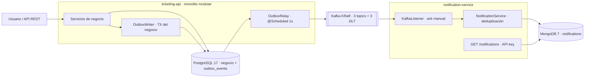
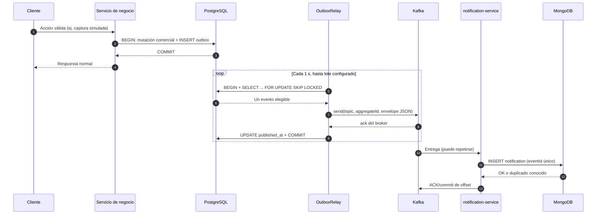

# F5-01 — Diseño técnico integral de Fase 5 (PROPUESTO)

- **Estado:** diseño propuesto al Tech Lead; no aprobado ni implementado.
- **Fecha:** 2026-11-14.
- **Rama / SHA estudiado:** `dev` / `73eb12d307af696533ba182574d7f9f54ab2ec42`.
- **CI base:** #310, `success`; 390 pruebas unitarias y 170 integraciones, Spotless y JaCoCo correctos.
- **Requisito de entrada:** cierres formales de Fases 3 y 4 y autorización explícita para implementar Fase 5.
- **Objetivo:** probar el proyecto actual **en local primero**; implementar después Transactional Outbox → Kafka → notification-service → MongoDB con notificaciones simuladas. Sin AWS, pagos reales ni correo real.

## 1. Fuentes y auditoría de la base existente

El alcance procede de la especificación técnica entregada, especialmente secciones 1–3, 12–16, 22 y 24. Se revisaron el árbol GitHub (431 entradas), los módulos Maven, migraciones hasta V16, servicios de transición, pruebas, documentación F4-01–F4-05 y ADR-016–022. **No hay una validación funcional local completa**, por lo que el diseño no presume un conocimiento empírico del 100 % de los caminos en ejecución.

| Componente | Presente en el SHA | Implicación |
| --- | --- | --- |
| Monorepo Java 21 / Spring Boot 3.5.16 | `ticketing-api`, `common-events`, `notification-service` | Mantener monolito modular, consumidor separado |
| PostgreSQL 17 y Flyway V1–V16 | Tablas negocio, operaciones, generaciones, outbox | No tocar migraciones históricas |
| V10 `outbox_events` | `id`, `aggregate_type`, `aggregate_id`, `event_type`, `payload`, `created_at`, `updated_at`, `published_at`, índice parcial de no publicados | Reutilizar V10 en primera versión, sin V17 |
| `EventEnvelope<T>` | `eventId`, `eventType`, `occurredAt`, `version`, `data` | Mantener este envoltorio; añadir records de datos |
| `notification-service` | Solo aplicación Spring Boot, web y Actuator | Añadir Kafka/Mongo y consulta protegida |
| Docker Compose `infra` | PostgreSQL, Redis, Kafka KRaft y Mongo, broker con auto-create desactivado | Crear tópicos explícitamente, ejecutar apps en host |
| Pruebas | PostgreSQL/Redis Testcontainers, CI #310 verde | Añadir tests Kafka/Mongo especializados |
| Contrato pagos | Solo SIMULATED; ADR-022 propuesto | No incluir proveedor real ni reabrir H84 fuera de aprobación |

**Deuda previa:** `docs/erd.md` todavía describe V1–V11 aunque el esquema contiene V12–V16. También resta dictamen de `EventCancellationService` (Fase 3) y de ADR-022/H84 (Fase 4). No alterar estos contratos sin autorización.

## 2. Requisitos y no objetivos

**Funcionales:** eventos `OrderConfirmed`, `OrderCancelled`, `OrderRefunded`, `ReservationExpired`, `EventCancelled`; tópicos `ticketing.orders`, `ticketing.reservations`, `ticketing.events`; 3 particiones y réplica 1 en desarrollo; publicación cada segundo desde outbox; consumidor con ack manual, 3 entregas máximas (intento inicial + 2 reintentos de 1 segundo), DLT `<topic>.DLT`; documento de notificación en Mongo; GET paginado `/notifications?userId=` con API key; notificación = texto simulado y registro, nunca email real. Idempotencia respaldada por índice único de `eventId` en Mongo.

**No funcionales:** atomicidad de negocio y outbox en una sola transacción PostgreSQL; reenvío **at-least-once** de Kafka, consumo idempotente; claves por ID de agregado para orden por partición; evitar bloquear el negocio si Kafka cae; integraciones con Testcontainers y pruebas manuales locales reproducibles; configuración por entorno sin secretos reales ni dependencia AWS.

**No objetivos:** exactly-once end-to-end; 2PC PostgreSQL/Kafka/Mongo; sagas, CQRS, Debezium/Kafka Connect, plataforma cloud, correo real, panel administrativo o rediseño de pagos.

## 3. Arquitectura de contenedores y flujo





**Garantía precisa:** el commit negocio/outbox es atómico; Kafka y PostgreSQL no forman una transacción distribuida. Si Kafka confirma el mensaje y la base falla antes de `published_at`, el mensaje reaparece. Eso es esperado; el consumidor deduplica por `eventId`.

## 4. Contrato de eventos V1

Reutilizar `EventEnvelope<T>` en `common-events` (no añadir brokers como dependencias a ese módulo). Crear records de datos con `recipientUserId`, `recipientEmail`, `correlationId`, el identificador del agregado y solo los campos necesarios para el texto simulado; para `EventCancelled` incluir nombre/título resumido del evento. No incluir tokens, firmas HMAC ni referencias financieras. UUID del sobre `eventId` **igual** a la PK `outbox_events.id`. `version=1`, `occurredAt` fijado al registrar, no al republicar. Payload JSONB de outbox = **sobre completo**, sin reconstrucción al reenvío. La clave Kafka = `aggregateId.toString()`.

| Tipo | Tópico | Agregado / clave Kafka | Momento único de publicación |
| --- | --- | --- | --- |
| `OrderConfirmed` | `ticketing.orders` | orderId | Pago confirmado **y** tickets emitidos/orden cumplida; no `UNFULFILLABLE` |
| `OrderCancelled` | `ticketing.orders` | orderId | Cambio efectivo de orden a `CANCELLED` (usuario, fallo de pago, cancelación de evento) |
| `OrderRefunded` | `ticketing.orders` | orderId | Confirmación real de reembolso y efecto comercial `APPLIED`, nunca `PENDING`/`FAILED`/`NO_OP` |
| `ReservationExpired` | `ticketing.reservations` | reservationId | Cambio efectivo de reserva `ACTIVE → EXPIRED` por TTL/expiración de orden; no por reenvío |
| `EventCancelled` | `ticketing.events` | eventId | Cambio efectivo a `CANCELLED`; propuesta: una notificación-evento por destinatario distinto |

**Destinatarios de EventCancelled (punto específico para aprobar):** el organizador y usuarios afectados se identifican desde `ticketing-api` en la misma transacción de cancelación; se emite un evento único por destinatario (cada uno con UUID propio, pero con la **misma clave Kafka eventId del agregado**). Así `notification-service` no consulta PostgreSQL ni necesita transacciones Mongo multidocumento. Duplicados de destinatario en un mismo evento se eliminan antes de insertar el outbox. El Tech Lead debe aceptar esta regla antes de implementarla.

**Correlación:** datos de evento contienen `correlationId`. Si la acción empieza por HTTP, registrar/capturar `X-Correlation-Id` mediante un filtro mínimo; en tareas programadas generar un UUID técnico. El relay lo transmite también como header Kafka, recuperándolo del payload persistido; la notificación registra solo IDs técnicos en logs.

**Compatibilidad:** `EventEnvelope` conserva sus cinco campos y los contratos públicos actuales no cambian. Un consumidor valida `version` y `eventType` y redirige evidencia no reconocida a DLT sin inventar notificaciones. Es posible agregar records sin cambiar el POM padre.

## 5. Escritura del outbox dentro de la transacción del negocio

Crear en `ticketing-api` una interfaz/servicio mínimo `OutboxWriter`, con persistencia JDBC y propagación `MANDATORY`, invocado **solo** después de confirmar una transición válida y mientras sigue abierta la misma transacción. No insertar un evento en un bloque `afterCommit` (se perdería la atomicidad); tampoco llamar a Kafka en los servicios de negocio.

Ejemplos de puntos de emisión: `OrderPaymentService.processSuccess` tras tickets; `OrderPaymentService.confirmRefund` tras confirmación; cancelación pendiente por `OrderCancellationService`, `OrderPaymentService.processFailure` o `EventCancellationService`; expiración por `ReservationExpirationService` y `OrderExpirationProcessor` cuando realmente expiran la reserva; `EventCancellationService` si cambia el estado del evento. Evitar doble publicación entre coordinadores y servicios internos.

Usar `created_at=clock_timestamp()` explícito al insertar el outbox para reflejar la hora real de inserción y no el comienzo de una transacción larga. Orden estable `(created_at,id)` por agregado; el test debe demostrar secuencia bajo carreras. En caso de fallo de negocio, **rollback también elimina el outbox**.

No alterar la máquina de estados ni la regla de pagos simulados. En el flujo técnico `TX-APPLY`, registrar el outbox en la transacción que ya aplica negocio; un `NO_OP` no genera notificación.

## 6. Relay Kafka mínimo y tolerante a fallos

**Elección recomendada para el portafolio:** reutilizar `outbox_events` V10 sin V17, con **una fila por transacción**, `SELECT FOR UPDATE SKIP LOCKED` y espera acotada del acuse Kafka. Mantener las transacciones muy cortas y no bloquear tablas de negocio. La publicación puede procesar hasta 50 filas secuenciales por ciclo `@Scheduled(fixedDelay=1000)`; cada mensaje usa su propia transacción.

Consulta conceptual; revisar `EXPLAIN ANALYZE` en Postgres local antes de afirmar rendimiento:

```sql
SELECT o.id, o.aggregate_type, o.aggregate_id, o.event_type, o.payload
FROM outbox_events o
WHERE o.published_at IS NULL
  AND NOT EXISTS (
    SELECT 1
    FROM outbox_events older
    WHERE older.aggregate_type = o.aggregate_type
      AND older.aggregate_id = o.aggregate_id
      AND older.published_at IS NULL
      AND (older.created_at, older.id) < (o.created_at, o.id)
  )
ORDER BY o.created_at, o.id
LIMIT 1
FOR UPDATE OF o SKIP LOCKED;
```

Mientras el registro está bloqueado, `KafkaTemplate<String,String>.send(...)` envía el **JSON almacenado** y se espera el acuse con timeout configurado (propuesta inicial: 2 s). Solo después se ejecuta `UPDATE outbox_events SET published_at=clock_timestamp(), updated_at=clock_timestamp() WHERE id=?` y COMMIT. Si el broker rechaza o no contesta, la transacción revierte y el evento sigue pendiente. No hacer loops de reintentos agresivos dentro del mismo lock.

**Orden por agregado:** el predicado `NOT EXISTS older` impide reclamar un evento nuevo mientras exista otro anterior del mismo agregado sin publicar; varios workers sí pueden procesar agregados distintos. La clave Kafka fija la partición en el tópico. Se probará el orden en dos procesos/threads de relay con PostgreSQL real. Con reloj/timestamps empatados, `id` ofrece un orden determinista; esto no equivale a un orden total global de commits y el caso deberá auditarse si se exige mayor garantía.

**Trade-off explícito:** el broker se consulta mientras hay una transacción PostgreSQL abierta. Se acepta provisionalmente solo para el laboratorio local por la espera corta y un único lock de outbox. **Si el Tech Lead rechaza I/O de Kafka bajo transacción**, proponer una V17 *nueva* con claim/lease y confirmación condicionada, previa autorización de esquema/locks, nunca ampliar V10 retrospectivamente. Ni esta propuesta ni los tests constituyen aprobación de V17.

Configurar `acks=all`, `enable.idempotence=true` y límites/reintentos de productor compatibles con Kafka; con **replicación 1 no existe HA**. Crear los tres tópicos y sus tres DLT explícitamente porque Compose desactiva auto-creación. Los DLT son `ticketing.orders.DLT`, `ticketing.reservations.DLT` y `ticketing.events.DLT`, cada uno con tres particiones y replicación 1. Los `NewTopic` de Spring Kafka pueden definirlos desde la API; inicio local: broker primero, API después, consumidor al final.

## 7. Consumidor e idempotencia MongoDB

Agregar a `notification-service` `spring-kafka`, `spring-boot-starter-data-mongodb` y dependencias de validación/test pertinentes; versiones desde BOM de Spring Boot y Testcontainers existente. No dependencia de notification-service hacia ticketing-api.

- `@KafkaListener` por tópico con `group.id=ticketing-notifications`, `enable.auto.commit=false` y `AckMode.MANUAL_IMMEDIATE`.
- Leer `String` JSON, validar `eventType`, `version=1`, destinatario, datos mínimos y convertir `data` al record adecuado con Jackson. No habilitar deserialización polimórfica arbitraria.
- Persistir un documento de notificación por mensaje (una persona destinataria); `eventId` único en MongoDB. Creación del índice **explícita** mediante `MongoTemplate.indexOps(...).ensureIndex(...)` en el arranque, no presumir creación automática por anotación.
- Documento: `eventId`, `type`, `recipientUserId`, `recipientEmail`, `subject`, `body`, `status` = `SENT`/`FAILED` (entrega **simulada**), `createdAt`. `SENT` significa «registrada y simulada», nunca envío SMTP real.
- Si `eventId` ya existe con el **mismo tipo/destinatario**, tratar como duplicado legítimo y ACK; si contradice la evidencia persistida, error a DLT. No hacer `exists → insert` sin restricción única (carrera).
- Confirmar offset después de guardar o reconocer el duplicado. Cuando Mongo falla, lanzar excepción sin ACK.
- `DefaultErrorHandler` + `FixedBackOff(1000,2)`: **tres entregas totales** (inicial + dos reintentos), luego `DeadLetterPublishingRecoverer` con destino explícito `<topic>.DLT` (no confiar en sufijo predeterminado `-dlt`). Confirmar recuperación solo después del ACK de publicación a DLT; probar esta interacción con `MANUAL_IMMEDIATE`.
- No implementar reenvío automático de DLT en Fase 5; documentar inspección/reprocesamiento manual seguro. Si la caída Mongo es temporal y supera los reintentos, la notificación queda en DLT y requiere intervención; no declarar recuperación automática.

**Endpoint requerido:** `GET /notifications?userId=<UUID>&page=0&size=20`, limitado a 100, orden `createdAt DESC, eventId`, autenticado mediante `X-Api-Key` de `NOTIFICATION_API_KEY` por variable entorno y comparación de tiempo constante. Acceso mínimo: no exponer colección sin API key; pruebas de 401, paginación y aislamiento por userId. Documentar que una **API key compartida no proporciona aislamiento por usuario**: se considera endpoint interno de desarrollo, nunca API pública multiusuario.

## 8. Infraestructura de desarrollo y observabilidad

Conservar `docker-compose.yml` perfil `infra` con PostgreSQL 17, Redis 7, Kafka 4 KRaft y MongoDB 7. En esta fase **las aplicaciones se ejecutan en el host**, con `KAFKA_BOOTSTRAP_SERVERS=localhost:9092` y `MONGODB_URI` apuntando a `localhost`. Los contenedores usan listeners internos separados; no intentar resolver `localhost` desde un contenedor como si fuera el broker.

El perfil `full`, Dockerfiles multi-stage, Grafana, Prometheus y AWS pertenecen a fases posteriores. Proponer métricas básicas de outbox pendiente, publicación con fallo, eventos consumidos, duplicados y DLT, junto con logs por `eventId`/`correlationId`, sin correos completos ni secretos. No exigir Grafana para aprobar Fase 5.

**Riesgos y controles**: (a) duplicado después del ACK Kafka y antes del commit PG → índice único Mongo; (b) Mongo caído → retries+DLT; (c) Kafka caído → outbox pendiente sin perder negocio; (d) relay concurrente → SKIP LOCKED y exclusión de anterior por agregado; (e) mensajes malformados → DLT; (f) API key ausente → rechazo al arrancar o 401, no modo abierto; (g) event cancellation fan-out → transacción acotada y deduplicación de destinatarios, sin acceso PG desde notification-service.

## 9. Entregas incrementales, todas con CI

| Incremento | Código/documentación y prueba del mismo cambio | Salida requerida |
| --- | --- | --- |
| F5-00 | **Primero validar en local** con `LOCAL_RUN.md`, seed del perfil dev y webhooks firmados; corregir bloqueos reales de arranque sin ampliar funcionalidades | Docker `healthy`, health 200, Swagger, reserva→orden→captura→tickets, evidencia registrada |
| F5-01 | Records de cinco eventos, JSON y contrato `EventEnvelope`, tests de serialización/versión, ADR de decisiones | Contrato V1 estable y aprobado |
| F5-02 | `OutboxWriter` y puntos de inserción transaccional, tests de rollback, idempotencia y todos los orígenes | Negocio+outbox atómicos |
| F5-03 | Producer, topics y relay; tests Kafka detenido/restaurado, duplicado y dos publishers sobre PostgreSQL | Outbox → Kafka con at-least-once y orden por agregado |
| F5-04 | Mongo, consumidor, API key, templates text blocks, retries y DLT; tests de duplicado/errores/endpoint | Un documento por eventId y consumo seguro |
| F5-05 | Integration Testcontainers PG/Redis/Kafka/Mongo y smoke local flujo completo con Awaitility | Notificación observada en Mongo, CI verde |
| F5-06 | Documento de operaciones, evidencia del test real local, matriz final, auditoría y decisión de cierre | Aprobación formal de Fase 5 |

## 10. Pruebas/aceptación obligatorias

El detalle de escenarios, evidencias y comando de ejecución está en [F5-02](F5-02-test-and-acceptance-plan.md). Preservar todos los tests actuales y el umbral JaCoCo de 70 % para `service`/`domain`; no reducir cobertura, no silenciar errores ni eliminar tests para obtener CI verde.

La prueba de extremo a extremo exigida por la especificación es: crear usuario/evento → reservar → crear orden → captura firmada SIMULATED → generar tickets → INSERT outbox transaccional → publicar Kafka → consumidor ACK → notificación simulada en MongoDB; todo con espera acotada por Awaitility, nunca `Thread.sleep`. Además incluir fallos, duplicación y DLT.

## 11. Dictamen solicitado / condiciones para iniciar

El Tech Lead debe aprobar expresamente: (1) un registro por transacción con ACK Kafka bajo lock de outbox; (2) matriz de eventos y su destinatario `EventCancelled`; (3) contrato V1 y versionado; (4) tres entregas totales y DLT `.DLT`; (5) política de consulta interna mediante API key; (6) secuencia de incrementos. Si se exige cambiar esquema, locks globales o API existente, autorización separada antes de implementar.

**Este documento es un diseño, no prueba de implementación. Fase 4 permanece abierta y Fase 5 bloqueada hasta los cierres y aprobaciones expresos.**

## 12. Documentación de referencia

- Especificación técnica Ticketing, secciones 12, 13, 15, 22 y 24.
- [PostgreSQL 17 — SELECT y SKIP LOCKED](https://www.postgresql.org/docs/17/sql-select.html); [restricciones](https://www.postgresql.org/docs/17/ddl-constraints.html).
- [Spring Kafka 3.3 — KafkaTemplate](https://docs.spring.io/spring-kafka/reference/3.3/kafka/sending-messages.html), [listeners y ACK](https://docs.spring.io/spring-kafka/reference/3.3/kafka/receiving-messages/message-listener-container.html), [errores y DLT](https://docs.spring.io/spring-kafka/reference/3.3/kafka/annotation-error-handling.html).
- [Spring Data MongoDB — creación de índices](https://docs.spring.io/spring-data/mongodb/reference/mongodb/mapping/mapping-index-management.html).
- [Spring Boot 3.5 — Testcontainers y ServiceConnection](https://docs.spring.io/spring-boot/3.5/reference/testing/testcontainers.html).
- [Testcontainers — Apache Kafka](https://java.testcontainers.org/modules/kafka/).
- [Docker Compose — perfiles](https://docs.docker.com/compose/how-tos/profiles/).
- [Apache Kafka — producer config](https://kafka.apache.org/40/configuration/producer-configs/).
- [Transactional Outbox, patrón de ingeniería](https://microservices.io/patterns/data/transactional-outbox.html) (referencia de patrón, no normativa oficial).
